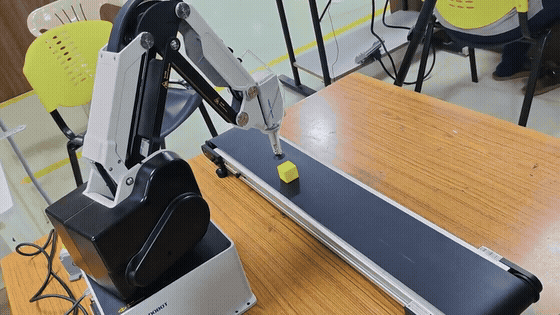
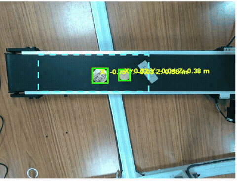
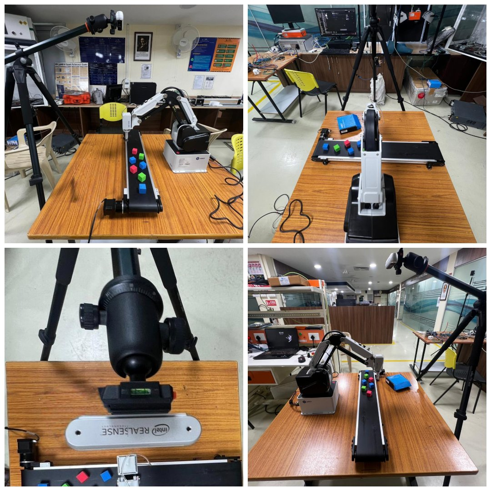
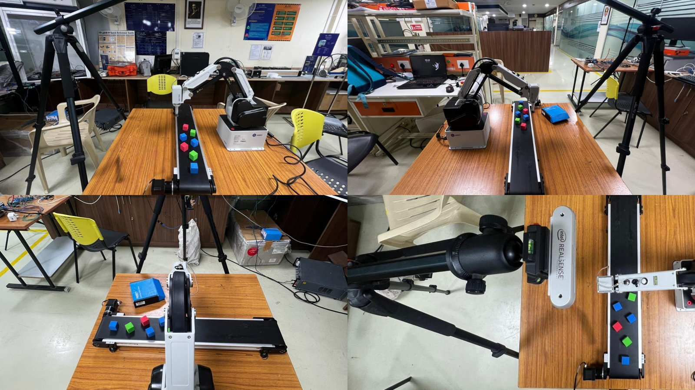
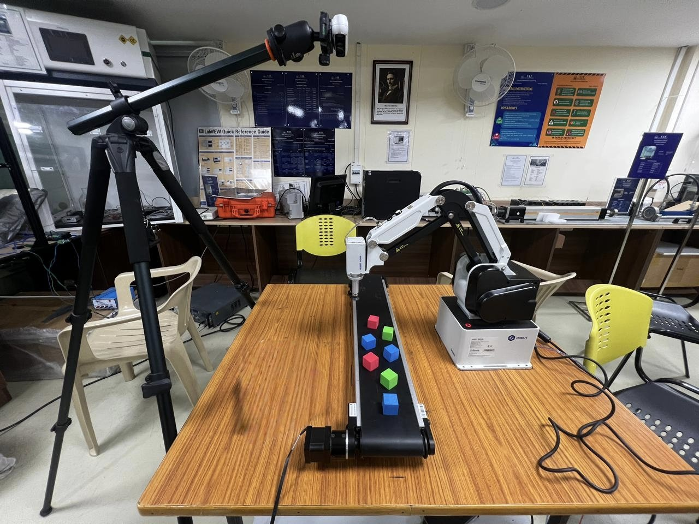
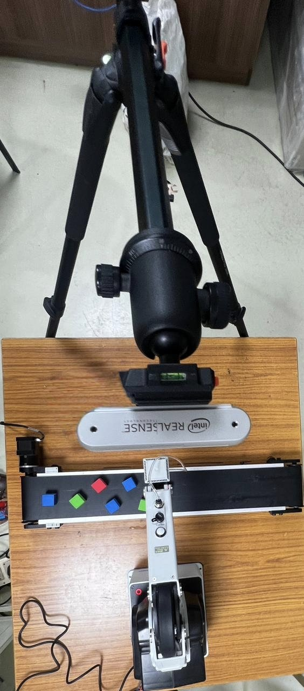

# 3D Vision-Based Robotic System for Non-Ferrous Scrap Sorting

**An RGB-D vision-guided pick-and-place system for automated scrap sorting.** An Intel RealSense D435i depth camera, fixed above the work area, detects objects on a conveyor. The system computes their 3D position from depth and transforms it into the robot's coordinate frame with a camera-to-robot (eye-to-hand) calibration. A **Dobot MG400** robot arm, controlled from MATLAB over TCP/IP, then moves to each object.


---

## Working Demonstration



| Video | What it shows |
|---|---|
| [▶ Non-ferrous detection with live 3D coordinates](media/videos/02-nonferrous-detection-live-coordinates.mp4) | Top-down RealSense view of the conveyor. Metal pieces are detected by blob analysis and labelled with live X / Y / Z coordinates. |
| [▶ RGB-D pipeline: depth, colour depth and point cloud](media/videos/03-rgbd-depth-pointcloud-coordinates.mp4) | MATLAB live view with four panels: RGB detection with ROI, depth map, colourised depth and live point cloud. Object coordinates stream to the console. |
| [▶ Camera-to-robot transform verification](media/videos/06-camera-to-robot-transform-verification.mp4) | Coloured cubes are placed on the conveyor. The MG400 moves to each detected cube using the calibrated camera-to-robot transform. |
| [▶ MG400 tracking on the moving conveyor](media/videos/04-mg400-tracking-moving-conveyor.mp4) | The robot follows a cube while the conveyor moves. |
| [▶ Object-tracking verification](media/videos/05-mg400-object-tracking-verification.mp4) | The robot follows an object as it is moved by hand. |
| [▶ MG400 ↔ MATLAB connection](media/videos/01-mg400-matlab-tcp-connection.mp4) | The MG400 is enabled and moved from MATLAB over its TCP/IP API. |



### Experimental setup

| | |
|---|---|
|  |  |
|  |  |

The RealSense D435i is mounted on a tripod looking down on the conveyor (eye-to-hand). The Dobot MG400 sits beside the conveyor, and a stepper-driven belt conveyor brings parts in.

---

## How it works

```
 RealSense D435i ──► aligned RGB + depth ──► ROI ──► HSV / blob segmentation ──► regionprops (centroid, bbox)
        │                                                                              │
        │ intrinsics (fx, fy, cx, cy) + depth scale                                    ▼
        └──────────────────────────────────────────────► pixel + median depth ──► camera XYZ (mm)
                                                                                       │
                                     camera→robot rigid transform  [R | t]  (from calibration)
                                                                                       ▼
                                   Dobot MG400 (TCP/IP: 29999 dashboard, 30003 move, 30004 feedback)
                                                     MOVL(x, y, z, r)  ──►  pick position
```

1. **RGB-D capture:** RealSense colour and depth streams at 640×480 and 30 fps, with depth aligned to colour.
2. **Detection by blob analysis:**
   - Inside a region of interest over the conveyor, objects are segmented either with HSV colour masks (red, green, blue and yellow test cubes) or with brightness thresholding (shiny metal pieces).
   - The mask is cleaned with morphological open/close and small-blob removal.
   - `regionprops` returns each object's centroid and bounding box.
3. **3D localisation:**
   - The median depth over each blob's pixels gives a robust Z value.
   - X and Y come from the pinhole model with the RealSense intrinsics.
4. **Camera-to-robot calibration (eye-to-hand, fixed camera):**
   - Cubes are detected by the camera, and the MG400 is jogged onto each one. The robot pose (`GetPose`) is recorded for each.
   - The rigid transform R, t between the two point sets is solved by **SVD (Kabsch / Arun method)** and saved for reuse.
5. **Verification and pick:** detected objects are transformed into robot coordinates. The MG400 is commanded with `MOVL`, with a Z safety limit, collision-recovery settings and error clearing.
6. **Conveyor integration:** an Arduino drives the stepper conveyor and reads a proximity sensor. The belt stops when a part arrives, and the MG400 then runs its pick-and-place sequence.

Full details are in [docs/system_overview.md](docs/system_overview.md).

## Key features

- 3D object localisation from an RGB-D camera: depth alignment, median-depth sampling, and a live point cloud
- Real-time detection by **blob analysis** (HSV segmentation + morphology + region properties). No training data is needed.
- **Eye-to-hand calibration** by point correspondence and SVD rigid-transform estimation. The calibration is saved and reloaded for runs.
- **Dobot MG400 control from MATLAB** through the TCP/IP dashboard/move/feedback API: `EnableRobot`, `MOVL`/`MOVJ`, `GetPose`, `ClearError`, `SetPostCollisionMode`
- Conveyor automation with Arduino (stepper motor + proximity sensor)
- Calibration verification with coloured cubes, static and on a moving conveyor

## Hardware

| Component | Role |
|---|---|
| **Intel RealSense D435i** | RGB-D camera, fixed above the conveyor |
| **Dobot MG400** | 4-axis desktop robot arm, controlled over Ethernet (configurable IP) |
| Belt conveyor + stepper motor + driver | Moves parts through the work area |
| Arduino Uno + proximity sensor | Conveyor control and part-arrival detection |
| PC with MATLAB | Vision, calibration and robot control |

## Software

MATLAB (Image Processing and Computer Vision toolboxes), the Intel RealSense SDK 2.0 with its MATLAB wrapper, and the MATLAB Support Package for Arduino.

## Source code

The source code is kept in a **private repository**. It is available to recruiters and interviewers on request: contact me via [GitHub @dhanushanand-dev](https://github.com/dhanushanand-dev).

This public repository is a showcase. It contains the README, the [technical write-up](docs/system_overview.md) and the demo media (`media/`).

The private source repository is laid out like this:

```
├── matlab/
│   ├── main/
│   │   ├── mg400_handeye_calibration.mlx       # detect cubes, record robot poses, solve camera→robot transform
│   │   └── mg400_transform_verification.mlx    # load transform, detect objects, move MG400 to them
│   ├── conveyor_integration/
│   │   └── mg400_conveyor_sorting.mlx          # Arduino conveyor + proximity sensor + MG400 pick-and-place
│   ├── development/                            # MG400 + RealSense development iterations
│   └── experiments/                            # early blob-tracking and background-subtraction tests
├── docs/system_overview.md
└── media/
```

## Results

- The calibrated system maps the camera detections to MG400 coordinates. The robot reaches each cube on the conveyor (see the transform-verification video) and tracks objects moving on the belt.
- Non-ferrous metal pieces on the conveyor are detected and localised in 3D in real time by blob analysis.
- Calibration and verification were done with coloured test cubes. The same pipeline localises the metal scrap pieces.

## Skills demonstrated

- RGB-D computer vision: depth alignment, 3D back-projection, point clouds
- Classical real-time detection: colour segmentation, morphology, blob analysis
- Hand-eye (eye-to-hand) calibration and rigid-transform estimation (SVD)
- Industrial robot integration: Dobot MG400 TCP/IP API from MATLAB
- Mechatronics: conveyor and sensor integration with Arduino
- System testing and verification on real hardware

## Acknowledgements

- Intel RealSense SDK and MATLAB wrapper (Intel Corporation)
- The rigid-transform estimation uses the standard SVD method (Arun, Huang & Blostein, 1987; Kabsch, 1976).

## Author

**Dhanush Anand** · [GitHub @dhanushanand-dev](https://github.com/dhanushanand-dev)
